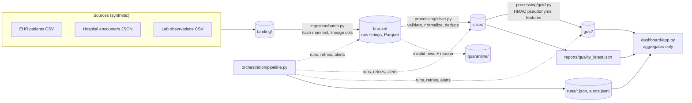

# Architecture

## Phase 1 (local MVP, implemented)

### Module responsibilities

| Module | Responsibility |
|---|---|
| `ingestion/sources/synthetic.py` | Generates patients, encounters and LOINC lab/vital observations with injected defects (duplicates, missing fields, bad dates, mixed units/timezones, orphans). |
| `ingestion/batch.py` | Bronze. Reads CSV/JSON/Parquet as raw strings, adds `_source_file`, `_source_system`, `_batch_id`, `_ingested_at`. SHA-256 manifest makes re-runs no-ops. Atomic writes. |
| `data_quality/checks.py` | Rule evaluation, quarantine split (first failing reason per row), latest-version dedupe, per-table quality report. |
| `processing/silver.py` | Typed, validated, normalized tables: `patients`, `encounters`, `diagnoses`, `observations`. Rejects go to `quarantine/` (dead-letter). |
| `processing/gold.py` | Pseudonymized `patient_features` and small-cell-suppressed `cohort_summary`. Refuses to write if a direct identifier would leak. |
| `orchestration/pipeline.py` | Runs steps in order, retries transient I/O with backoff, writes a run record per run, raises alerts on failure or quality below threshold. |
| `dashboard/app.py` | Streamlit monitor: run status, freshness, quality, rejections, missing values, throughput, cohort aggregates, alerts. |
| `healthcare_models/schemas.py` | Source files, required fields, code systems, unit conversions, PII column list. |

## Key design decisions

1. **Bronze keeps raw strings.** Typing happens in Silver so a malformed value is quarantined with a reason instead of failing the load or being silently coerced.
2. **Silver is a full rebuild from Bronze** each run. Deterministic and idempotent, which is simple and correct at MVP scale. Phase 4 replaces it with incremental MERGE on Iceberg tables.
3. **Corrections win by ingestion time.** Dedupe keeps the latest *valid* version of each business key, so a corrected record in a later batch replaces the old one, and a broken correction does not erase a good record.
4. **Validate, then dedupe.** Each rejected row keeps the first failing rule, so reasons are unambiguous and countable.
5. **No cross-system identity assumption.** Records link only on the source `patient_id`. Rows whose patient is not in Silver are quarantined as `patient_not_in_silver`. Probabilistic matching (MPI) is future work and needs validation before use.
6. **Gold contains no direct identifiers.** Patient IDs become HMAC-SHA256 pseudonyms (key from env/Secrets Manager), birth date becomes age capped at 90, and names, phone and postal code are dropped. Aggregates below 5 are suppressed. This is pseudonymization, not certified de-identification.
7. **Units are canonicalized to UCUM** (glucose mmol/L to mg/dL), and plausibility ranges are applied in canonical units.

## Data model and FHIR mapping

| Silver table | Key | FHIR R4 resource | Notes |
|---|---|---|---|
| patients | patient_id | Patient | `sex` maps to `gender` (M/F/U to male/female/unknown) |
| encounters | encounter_id | Encounter | `start_time` (UTC) maps to `period.start`; `encounter_type` maps to `class` |
| diagnoses | encounter_id + code | Condition | ICD-10 in `code.coding`, `recorded_at` maps to `recordedDate` |
| observations | observation_id | Observation | LOINC `code`, `valueQuantity` in UCUM, `effective_time` maps to `effectiveDateTime` |

Every Silver row carries provenance (`_source_file`, `_source_system`, `_batch_id`, `_ingested_at`).
Not yet modeled: procedures, medications, allergies, providers, facilities (only `facility_id` is carried).

## Path to AWS (Phases 2–4, not implemented)

| Local | AWS |
|---|---|
| `data/landing`, `bronze`, `silver`, `gold` | S3 buckets/prefixes, SSE-KMS, Block Public Access, Iceberg tables |
| `ingestion/batch.py` | S3 event → Lambda (small files) / Glue job |
| `processing/*.py` (pandas) | Glue PySpark jobs, same rules ported |
| `orchestration/pipeline.py` | Step Functions state machine with Retry/Catch |
| `alerts.jsonl` | SNS topic + CloudWatch alarms |
| `runs/*.json` | CloudWatch metrics + DynamoDB/S3 run log |
| `HDP_PSEUDONYMIZATION_KEY` env | Secrets Manager |
| dashboard | Streamlit on ECS behind auth, or QuickSight over Athena |
